# istop

[](LICENSE)
[](https://github.com/GladTechInfo/istop/releases/latest)
[](https://github.com/GladTechInfo/istop/actions/workflows/ci.yml)
[](#11-development)


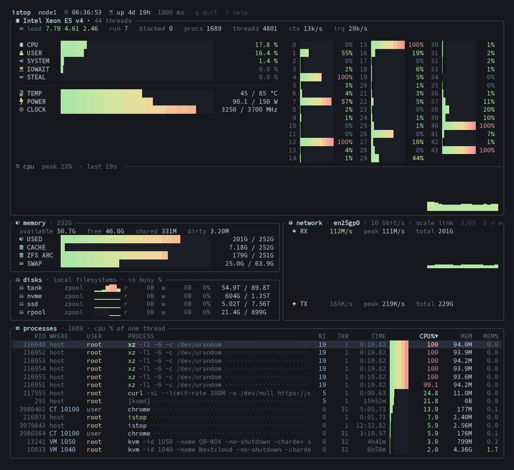

**Install** — on any x86-64 Linux, one command installs the latest release (`.deb`, `.rpm` or a
static binary, checked against the release's `SHA256SUMS`):

```sh
sh -c "$(curl -fsSL https://raw.githubusercontent.com/GladTechInfo/istop/main/install.sh)"
```

Then run `istop`; `q` quits and `?` lists every key. More in [Quick Start](#4-quick-start) and
[Installation](#5-installation).

**A terminal system monitor for Linux: CPU, memory, disks, network and processes in one screen.**
It labels every process with the Proxmox container or VM, Docker or Podman container it runs in,
shows ZFS pools and the ARC the way ZFS counts them, and scales network graphs to the port's link
speed. It is the system-wide companion to [igtop](https://github.com/GladTechInfo/igtop) (GPUs) and
[iztop](https://github.com/GladTechInfo/iztop) (ZFS pools), and shares their look.

## Contents

1. [Introduction](#1-introduction)
2. [Features](#2-features)
3. [Screenshots](#3-screenshots)
4. [Quick Start](#4-quick-start)
5. [Installation](#5-installation)
6. [Usage Guide](#6-usage-guide)
7. [Keyboard Shortcuts](#7-keyboard-shortcuts)
8. [Understanding the Interface](#8-understanding-the-interface)
9. [Advanced Usage](#9-advanced-usage)
10. [Technical Details](#10-technical-details)
11. [Development](#11-development)
12. [Licence](#12-licence)

---

## 1. Introduction

### What istop is

istop is an interactive system monitor that runs in a terminal, in the tradition of `top`, `htop`
and `btop`. One screen shows how busy each processor thread is, how memory is used, how much space
and I/O each disk has, how much network traffic is flowing, and which processes are responsible.
You can sort, filter and inspect processes, send them signals and change their priority.

### The problem it solves

General-purpose monitors treat a virtualisation host like any other machine, which hides the
questions that matter on one:

| Question | What istop does |
|---|---|
| Which guest is this process? | The **WHERE** column names the Proxmox container (`CT 101`) or VM (`VM 105`), or `docker` / `podman`. |
| Who owns this process inside an unprivileged container? | Users are looked up in that container's own user list, so they show by name rather than as a shifted number such as `100033`. |
| Is memory really full on a ZFS host? | The ZFS ARC, which the kernel counts as *used* although most of it can be reclaimed, has its own bar. |
| How full is the pool? | ZFS pools are shown once each, with space as `zfs list` counts it and I/O from the member disks. |
| How much of the 10 Gbit/s port is in use? | The network graph's full height is the port's link speed by default. |

istop also never writes its configuration file unless you press `W` (`Shift`+`W`), so trying a setting never
changes your defaults by accident.

### Who it is for

- **Linux beginners** who want a clear, readable picture of what their machine is doing.
- **Proxmox VE, Docker and Podman administrators** who need to see which guest is responsible for
  load.
- **ZFS users**, who get pool space and ARC figures that match ZFS's own tools.
- **Advanced users and developers**, who get a scriptable `--once` mode and documented data sources.

---

## 2. Features

| Area | Features |
|---|---|
| **CPU** | Busy, user, system, iowait and steal; temperature, package power and clock where available; one bar per thread; ten minutes of history; load averages, running and blocked tasks, context switches and interrupts. |
| **Memory** | Used, cache and swap; on ZFS hosts, the ARC against its ceiling; available, free, shared and dirty memory. |
| **Disks** | Local filesystems and ZFS pools: space, read and write rates, and a history of how busy each device is. A menu (`d`) chooses which are shown and in what order. |
| **Network** | Receive and send graphs for one interface, scaled to the link speed, automatically, or to a fixed rate. Follows the busiest physical port unless you choose one. |
| **Processes** | Flat list or tree; sort by any column; filter; a detail box with CPU history, disk I/O, cgroup and command line; signals and renice; mouse support. |
| **Containers** | Proxmox CT and VM, Docker and Podman labels on every process; container users by name. On Proxmox VE, a guests view (`v`) lists each VM and container as one row, its processes added together, in VMID order. |
| **Header** | Host name, clock, uptime, battery, and the container istop itself runs in. |
| **Configuration** | Optional `key = value` file, written only when you press `W` (`Shift`+`W`). |
| **Scripting** | `--once` prints every figure as plain text. |
| **Small and safe** | One static binary with no dependencies; written in Rust with `#![forbid(unsafe_code)]`. |

---

## 3. Screenshots

All screenshots and animations are genuine captures of istop on a Proxmox VE host — a 44-thread
Xeon with 252 GiB of memory, four ZFS pools, a 10 Gbit/s port, and its own VMs and containers —
during a few minutes of extra load: six `xz` processes, a download and a large file read from a
pool. To keep the host private, its name, the CPU's model number, pool names, three website names
and one file path were replaced after capture (the host appears as `node1`), cell for cell; every
figure, colour and layout is as istop drew it.

**The whole screen, with each area numbered** — explained in
[Understanding the Interface](#8-understanding-the-interface).

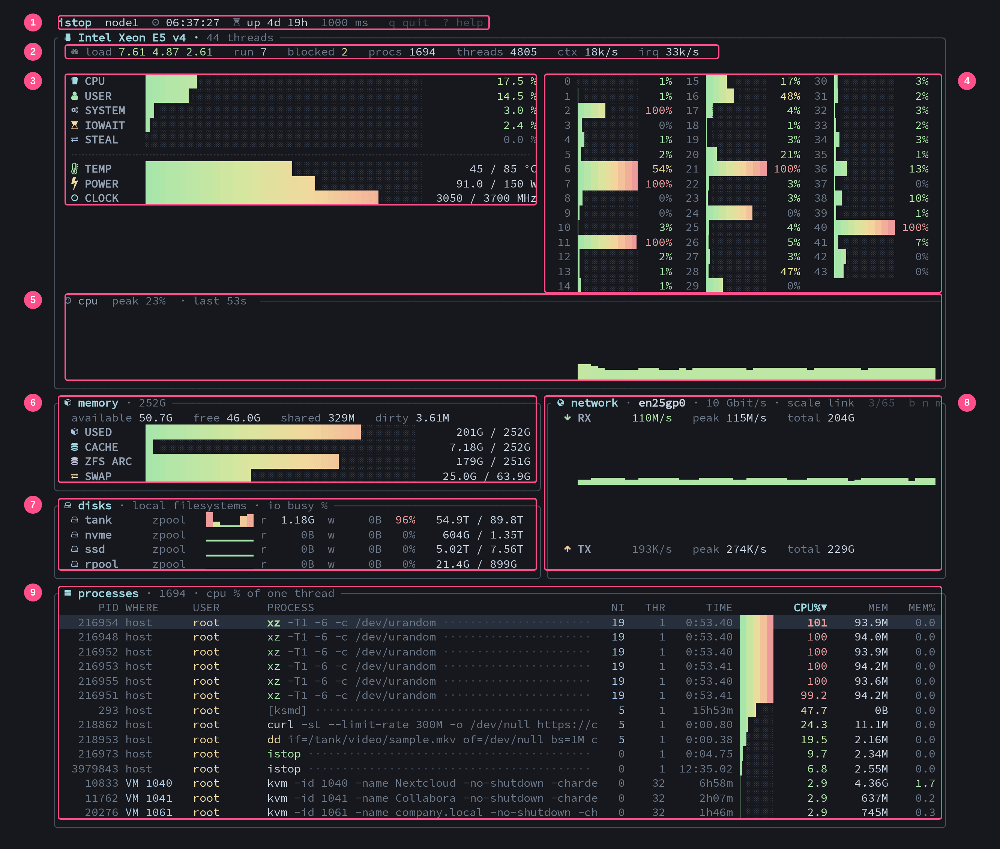

**The detail box** (`Enter`) for the busiest process, above the process list.

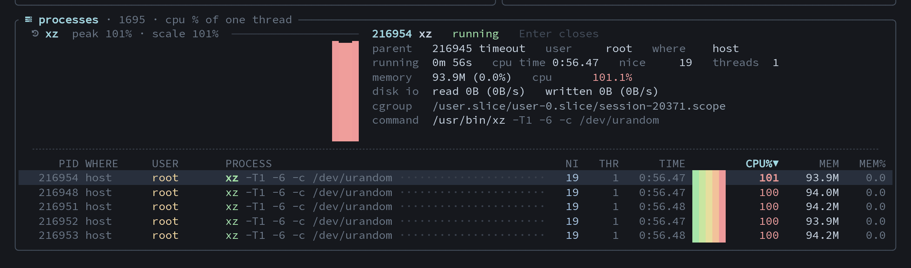

**Guests first** (`v`) — one row per Proxmox VM and container, its processes added together, in
VMID order; `Enter` on a guest row lists its processes, and `e` switches to the tree.

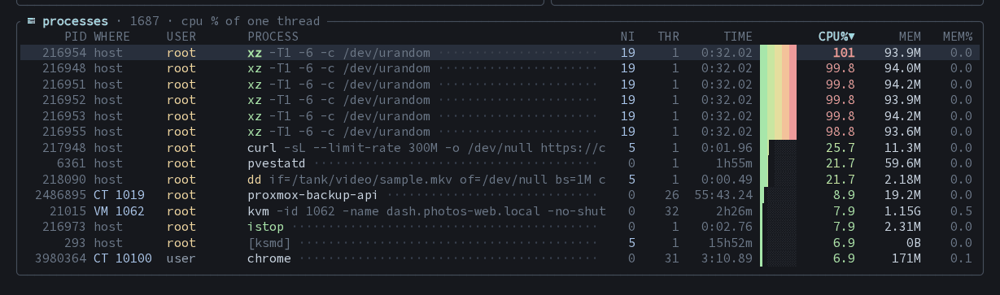

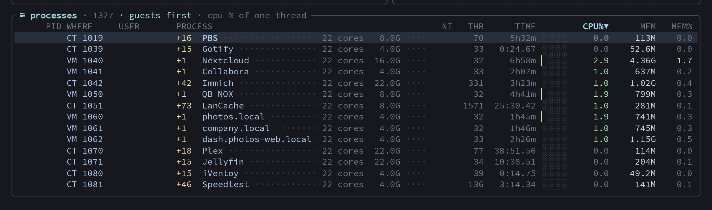

**Tree view** (`e`) — each process under its parent.

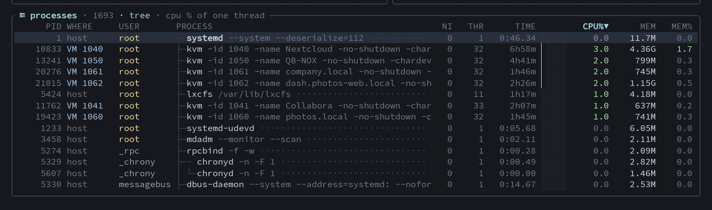

---

## 4. Quick Start

On any x86-64 Linux, one command installs the latest release:

```sh
sh -c "$(curl -fsSL https://raw.githubusercontent.com/GladTechInfo/istop/main/install.sh)"
istop                  # start the monitor; q quits, ? lists every key
```

The [install script](install.sh) picks the release file for your system — the `.deb` on Debian,
Ubuntu and Proxmox VE, the `.rpm` on Fedora, RHEL and openSUSE, the static binary in
`/usr/local/bin` everywhere else, Arch Linux and Alpine included — checks it against the release's
`SHA256SUMS` and installs it, using `sudo` when you are not root. It prints each command it runs.
istop runs as an ordinary user; `sudo istop` adds a few figures (see [Permissions](#permissions)).

Run the same command again to update. To remove istop:

```sh
curl -fsSL https://raw.githubusercontent.com/GladTechInfo/istop/main/install.sh | sh -s -- --uninstall
```

The script also takes `--version X.Y.Z` (a particular release), `--method deb|rpm|bin` (another
file than the one it picks) and `--bindir DIR` (where the static binary goes), after `sh -s --` as
above. To do each step by hand, or to build from source, see [Installation](#5-installation).

---

## 5. Installation

### 5.1 Requirements

| Requirement | Details |
|---|---|
| **Operating system** | Linux on x86-64 (64-bit Intel or AMD processors). |
| **Privileges** | None. Root adds CPU package power, other users' disk I/O, and signals or renice for other users' processes. |
| **ZFS** (optional) | On ZFS hosts, the `zfs` and `zpool` commands, for pool space and members. The ARC figure needs only the kernel module. |
| **Font** | A [Nerd Font](https://www.nerdfonts.com/) in your terminal for the icons; otherwise use `--no-icons` or press `i`. |

Everything else is read from `/proc` and `/sys`; there is no daemon and nothing to configure first.

### 5.2 Choosing an installation method

| Method | Best for | Updates |
|---|---|---|
| [Release package](#53-release-packages-deb-and-rpm) (`.deb`, `.rpm`) | Debian, Ubuntu, Proxmox VE, Fedora, RHEL and rebuilds, openSUSE | Install the newer package |
| [Arch Linux / CachyOS package](#54-arch-linux-and-cachyos) | Arch Linux, CachyOS and other Arch-based systems | Rebuild with `makepkg` |
| [Static binary](#55-other-distributions-static-binary) | Any other x86-64 distribution, including Alpine | Replace the file |
| [From source on GitHub](#56-building-from-source-github) | Developers; unreleased changes | `git pull` and rebuild |

A **package-manager installation** puts istop under `/usr/bin` and lets your package manager track,
update and remove it. A **manual installation** (static binary or a source build) puts it wherever
you copy it — usually `/usr/local/bin` — and you update and remove it yourself.

### 5.3 Release packages (.deb and .rpm)

Every [GitHub release](https://github.com/GladTechInfo/istop/releases/latest) carries four files:

| File | For | Installs to |
|---|---|---|
| `istop_<version>-1_amd64.deb` | Debian, Ubuntu, Proxmox VE | `/usr/bin/istop` |
| `istop-<version>-1.x86_64.rpm` | Fedora, RHEL, Rocky Linux, AlmaLinux, openSUSE | `/usr/bin/istop` |
| `istop-<version>-x86_64-linux` | Any x86-64 Linux | wherever you copy it |
| `SHA256SUMS` | Checksums of the three files above | |

All three contain the same statically linked binary, so they behave identically everywhere and
depend on no system libraries. Before a release's files are uploaded, the release workflow installs,
runs and removes each package in containers of Debian 12 and 13, Ubuntu 22.04 and 24.04, Fedora,
Rocky Linux 9, openSUSE Tumbleweed and Alpine.

These are packages attached to GitHub releases, not packages in your distribution's own
repositories: `apt install istop` or `dnf install istop` without a file name will not find them.

**Step 1 — download the package and its checksums:**

```sh
ver=$(curl -s https://api.github.com/repos/GladTechInfo/istop/releases/latest | sed -n 's/.*"tag_name": "v\(.*\)".*/\1/p')
base=https://github.com/GladTechInfo/istop/releases/download/v$ver
curl -LO "$base/SHA256SUMS"
curl -LO "$base/istop_${ver}-1_amd64.deb"        # Debian, Ubuntu, Proxmox VE
curl -LO "$base/istop-${ver}-1.x86_64.rpm"       # Fedora, RHEL, openSUSE
```

To install a particular version instead of the latest, set it by hand, for example `ver=0.4.0`.

**Step 2 — check the download.** This must print `OK` for the file you downloaded:

```sh
sha256sum --check --ignore-missing SHA256SUMS
```

The packages are not signed; this checksum is the check that the file is the one published here.

**Step 3 — install it** with the command for your distribution:

| Distribution | Install command | Notes |
|---|---|---|
| Debian 12, 13 | `sudo apt install ./istop_*_amd64.deb` | The `./` tells `apt` to install a local file. |
| Ubuntu 22.04, 24.04 and later | `sudo apt install ./istop_*_amd64.deb` | As Debian. |
| Proxmox VE | `sudo apt install ./istop_*_amd64.deb` | As root, omit `sudo`. |
| Fedora | `sudo dnf install ./istop-*.x86_64.rpm` | |
| RHEL, Rocky Linux, AlmaLinux | `sudo dnf install ./istop-*.x86_64.rpm` | |
| openSUSE Tumbleweed, Leap | `sudo zypper install --allow-unsigned-rpm ./istop-*.x86_64.rpm` | `zypper` refuses unsigned local packages without the flag. |

**Step 4 — confirm it works:** `istop --version`, then `istop`.

### 5.4 Arch Linux and CachyOS

istop is **not yet in the AUR**: the package is ready, but AUR account registration was paused when
it was prepared. Until it is published, build the same package from this repository with
`makepkg`, which downloads the release's source, compiles it, runs the tests and installs the result
under `/usr/bin` through `pacman`:

```sh
sudo pacman -S --needed git base-devel rust      # build tools, if not already installed
git clone https://github.com/GladTechInfo/istop
cd istop/packaging/aur
makepkg -si                                       # build, then install with pacman
```

CachyOS and other Arch-based distributions use the same steps. If you use `rustup` rather than the
`rust` package, leave `rust` out of the first command. To remove it later: `sudo pacman -R istop`.

### 5.5 Other distributions (static binary)

The static binary runs on any x86-64 Linux distribution, whatever its C library, so it suits Alpine,
Void, Gentoo, Slackware and others:

```sh
ver=$(curl -s https://api.github.com/repos/GladTechInfo/istop/releases/latest | sed -n 's/.*"tag_name": "v\(.*\)".*/\1/p')
base=https://github.com/GladTechInfo/istop/releases/download/v$ver
curl -LO "$base/SHA256SUMS"
curl -LO "$base/istop-${ver}-x86_64-linux"
sha256sum --check --ignore-missing SHA256SUMS                     # must print OK
sudo install -m 0755 "istop-${ver}-x86_64-linux" /usr/local/bin/istop
```

`install -m 0755` copies the file and makes it executable for every user.

### 5.6 Building from source (GitHub)

**Step 1 — install Git, a C linker and `curl`:**

| Distribution | Command |
|---|---|
| Debian, Ubuntu, Proxmox VE | `sudo apt install git curl build-essential` |
| Fedora, RHEL, Rocky, Alma | `sudo dnf install git curl gcc binutils` |
| openSUSE | `sudo zypper install git curl gcc binutils` |
| Arch Linux, CachyOS | `sudo pacman -S --needed git curl base-devel` |
| Alpine | `sudo apk add git curl build-base` |

**Step 2 — install Rust 1.88 or later** with [rustup](https://rustup.rs/), the official installer
(distribution packages are often older — Debian 12 ships 1.63):

```sh
curl --proto '=https' --tlsv1.2 -sSf https://sh.rustup.rs | sh
. "$HOME/.cargo/env"          # make cargo available in this terminal
rustc --version               # should print 1.88.0 or later
```

On Arch Linux and CachyOS, `sudo pacman -S rustup && rustup default stable` does the same.

**Step 3 — download the source code and enter it:**

```sh
git clone https://github.com/GladTechInfo/istop
cd istop
```

**Step 4 — build a release binary:**

```sh
cargo build --release
```

Cargo downloads the libraries istop uses, compiles everything with optimisations and writes the
program to `target/release/istop`.

**Step 5 — run it:** `./target/release/istop`

**Step 6 — install it system-wide (optional):**

```sh
sudo install -m 0755 target/release/istop /usr/local/bin/istop
```

**Step 7 — update to the latest source later:**

```sh
cd istop
git pull
cargo build --release
sudo install -m 0755 target/release/istop /usr/local/bin/istop
```

To build a particular release, check out its tag first, for example `git checkout v0.4.0`. For a
static binary that runs on other machines, see [Static builds](#static-builds).

### 5.7 Updating

| Installed with | How to update |
|---|---|
| Install script | Run the install command again. |
| `.deb` package | Download the newer `.deb` and install it the same way; `apt` replaces the old version. |
| `.rpm` package | Download the newer `.rpm` and install it the same way. |
| `makepkg` (Arch, CachyOS) | `cd istop && git pull && cd packaging/aur && makepkg -si` |
| Static binary | Download the newer binary and repeat the `install` command. |
| Source build | See step 7 above. |

### 5.8 Uninstalling

| Installed with | How to remove |
|---|---|
| Install script | `curl -fsSL https://raw.githubusercontent.com/GladTechInfo/istop/main/install.sh \| sh -s -- --uninstall` |
| `.deb` package | `sudo apt remove istop` |
| `.rpm` package (Fedora, RHEL) | `sudo dnf remove istop` |
| `.rpm` package (openSUSE) | `sudo zypper remove istop` |
| `makepkg` (Arch, CachyOS) | `sudo pacman -R istop` |
| Static binary or source build | `sudo rm /usr/local/bin/istop`, and delete the cloned directory if you have one. |

The only file istop ever writes is its configuration file, and only when you press `W` (`Shift`+`W`). To remove
it too: `rm -r ~/.config/istop`.

---

## 6. Usage Guide

### Starting istop

```sh
istop
```

istop fills the terminal with five areas: the header, CPU, memory and disks, network, and
processes. Press `?` at any time for the list of keys, and `q` to quit. A larger terminal shows more
— more process rows, longer history and a detail box with room to spare.

<a id="permissions"></a>
### Permissions

| As an ordinary user | Additionally as root (`sudo istop`) |
|---|---|
| Every figure, except those in the next column. | CPU package **power** (the RAPL energy counters are root-only). |
| Disk I/O of your own processes in the detail box. | Disk I/O of every process. |
| Signals and renice for your own processes; lowering priority only. | Signals and renice for any process, including raising priority. |

### Everyday examples

| Command | What it does |
|---|---|
| `istop` | The monitor. |
| `sudo istop` | Adds CPU power and every process's disk I/O. |
| `istop -s mem` | Sorts processes by memory. |
| `istop -s mem -r` | The same, smallest first. |
| `istop -f nginx --tree` | Starts filtered to processes matching `nginx`, in tree view. |
| `istop -i 500` | Samples twice a second. |
| `istop --once` | Prints one plain-text snapshot and exits. |
| `istop --default-config` | Prints every setting with its description. |

### Working with processes

1. **Select** a process with `↑` `↓`, `PgUp` `PgDn`, `Home` `End`, or a mouse click.
2. **Sort** with `←` `→` to move between columns; `r` reverses the order. The sorted column has a
   `▼` or `▲` beside its name.
3. **Filter** with `/` or `f`, type part of a name, command line, user or container label, or an
   exact PID, and press `Enter` to keep the filter (`Esc` clears it). Matching ignores case. The
   process box's title shows the filter.
4. **Inspect** with `Enter` (or a second click on the selected row): the detail box opens above the
   list. `Enter` again or `Esc` closes it.
5. **Act** with `k` for the signal menu or `N` to renice. Both ask for confirmation through their
   own menu, and `Esc` cancels.
6. **Per guest** on Proxmox VE: `v` lists every VM and container first, one row each with its
   processes added together, so each guest's CPU and memory can be read at a glance. `Enter` on a
   guest row lists its processes beneath it; `o` changes the guests' order.

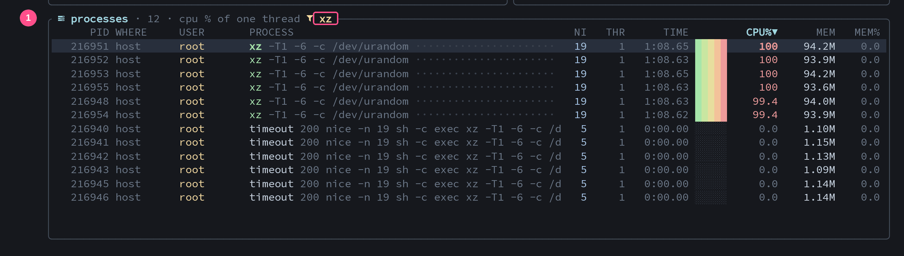

*After `/`, `x`, `z`, `Enter`: the list shows only processes matching `xz` (1) — the busy `xz`
processes and the `timeout` commands that started them.*

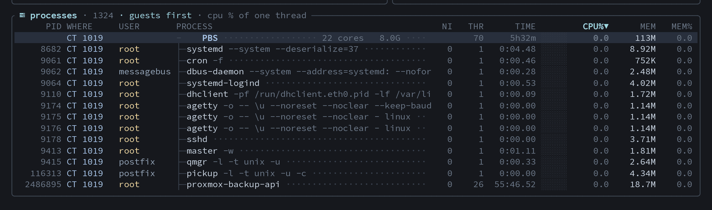

*After `v`, then `Enter` on the first guest row: the container's processes are listed beneath it,
with their users by name from the container's own user list.*

### Troubleshooting

| Symptom | Cause and remedy |
|---|---|
| CPU power is missing or `n/a` | The RAPL counters are readable by root only; run `sudo istop`. Inside a VM or container they are usually absent. |
| No CPU temperature | The CPU's sensor driver is not loaded (`k10temp` or `zenpower` on AMD, `coretemp` on Intel), or istop runs in a VM. `ls /sys/class/hwmon/*/name` lists the sensors the kernel offers. |
| A ZFS pool is missing from the disks box | istop needs the `zfs` and `zpool` commands: check that `zfs list` works. Also check `disk_hidden` in the configuration, or press `d`. |
| A disk you hid has gone for good | Press `d`, then `r`, to show every disk again in the default order. |
| A network share is missing from the disks box | By design: network filesystems are never shown, because asking an unreachable server for its free space blocks. |
| Squares or question marks instead of icons | The terminal font lacks Nerd Font glyphs. Install a [Nerd Font](https://www.nerdfonts.com/), or use `--no-icons` (`icons = false` to keep it). |
| `Illegal instruction` from a binary you built | Your Rust standard library contains AVX-512; see [Static builds](#static-builds). |
| The configuration file is reported as having errors | istop reports each faulty line with its number and applies the rest; `istop --default-config` shows the valid keys. |

---

## 7. Keyboard Shortcuts

Press `?` or `F1` in istop for this list. Help closes on any key.

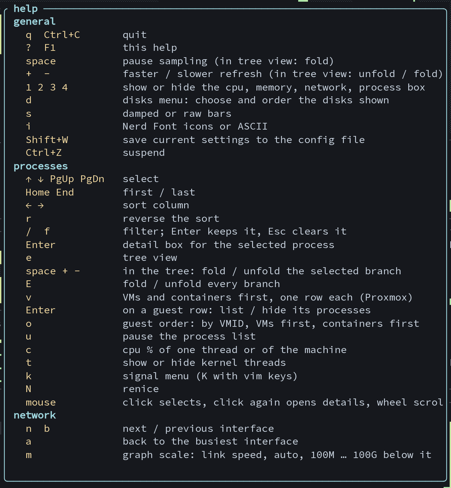

### General

| Key | Action | Explanation |
|---|---|---|
| `q`, `Ctrl+C` | Quit | Restores the terminal and exits. |
| `Esc` | Close, clear or quit | Clears an active filter first; otherwise closes the detail box; otherwise quits. |
| `?`, `F1` | Help | Shows every key; any key closes it. |
| `Space` | Pause or resume | Stops sampling and freezes the display. Every rate starts afresh on resume. In tree view, `Space` folds or unfolds the selected branch instead. |
| `+` (or `=`) | Sample faster | Steps the interval down: 10000 → 5000 → 2000 → 1000 → 500 → 250 → 100 ms. In tree view, unfolds the selected branch instead. |
| `-` (or `_`) | Sample slower | Steps the interval up the same ladder. In tree view, folds the selected branch instead. |
| `1` `2` `3` `4` | Show or hide boxes | `1` CPU, `2` memory and disks, `3` network, `4` processes. At least one box always stays shown; the remaining boxes take the space. |
| `d` | Disks menu | Choose which disks and pools are shown, and in what order. See [Disks menu](#disks-menu). |
| `s` | Damping on or off | Damped bars (rise fast, fall slowly) or raw bars. |
| `i` | Icons or ASCII | Nerd Font glyphs or plain ASCII letters. |
| `W` (`Shift`+`W`) | Save settings | Writes the current settings to the configuration file. Nothing is saved otherwise. |
| `Ctrl+Z` | Suspend | Returns you to the shell; `fg` resumes istop. |

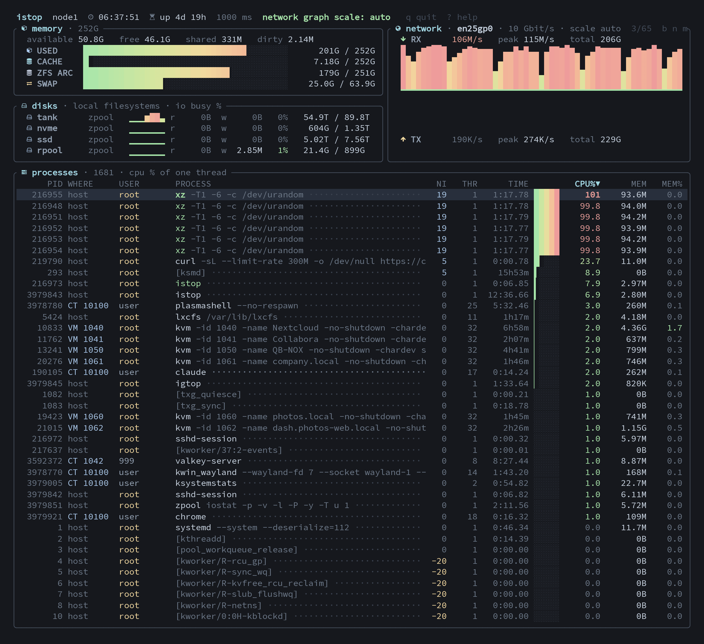

*After `1`: the CPU box is hidden and the process list takes the space. Press `1` again to bring it
back.*

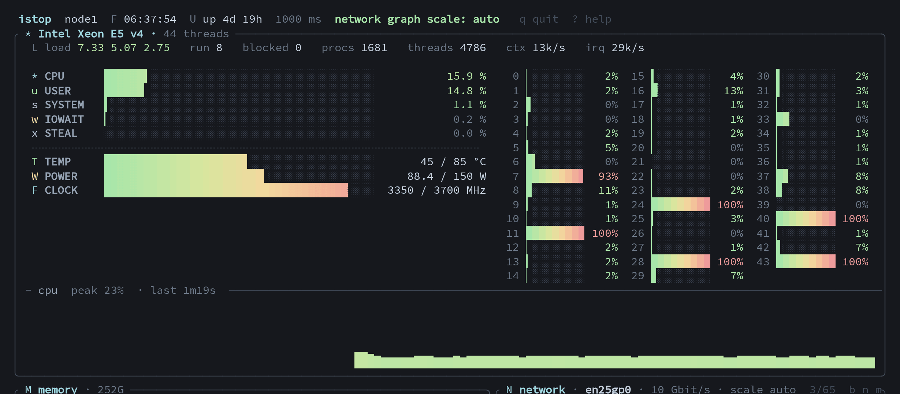

*After `i`: icons are replaced by ASCII characters, for terminals without a Nerd Font.*

### Processes

| Key | Action | Explanation |
|---|---|---|
| `↑` `↓` | Select | Moves the selection one row. |
| `PgUp` `PgDn` | Select by page | Moves one screenful. |
| `Home` `End` | First or last | Jumps to the top or bottom of the list. |
| `←` `→` | Sort column | Moves the sort to the previous or next column. |
| `r` | Reverse | Reverses the sort order. |
| `/`, `f` | Filter | Type to filter; `Backspace` edits; `Enter` keeps the filter; `Esc` clears it. `Delete` also clears a kept filter. |
| `Enter` | Detail box | Opens or closes the detail box for the selected process. Needs a process box at least 14 rows high. |
| `e` | Tree view | Switches between the flat list and the tree. |
| `E` | Fold or unfold all | In tree view: folds every branch, or unfolds them all if any are folded. |
| `v` | Guests first | On Proxmox VE: one row per VM and container, its processes added together, above the host's own processes (title: **guests first**). `Enter` on a guest row lists or hides its processes. Signals and renice act on single processes only. |
| `o` | Guest order | With guests first: by VMID alone, VMs and containers mixed (`vmid`); VMs then containers (`vm-first`); or containers then VMs (`ct-first`, the Proxmox tree's default), each type in VMID order. |
| `u` | Pause the list | Freezes the process list (title: **list paused**) while the rest keeps updating, so rows stop moving while you read or select. |
| `c` | CPU % basis | Switches between a share of **one thread** (as `top`: four busy threads read 400) and a share of the **whole machine**. The process box title says which. |
| `t` | Kernel threads | Shows or hides kernel threads. |
| `k` | Signal menu | Opens the signal menu for the selected process (`K` when `vim_keys` is on). |
| `N` | Renice | Opens the renice menu for the selected process. |

**Signal menu.** Press the letter of a signal to send it, or any other key to cancel. The result
(`sent TERM to 1234`, or the error) appears in the header.

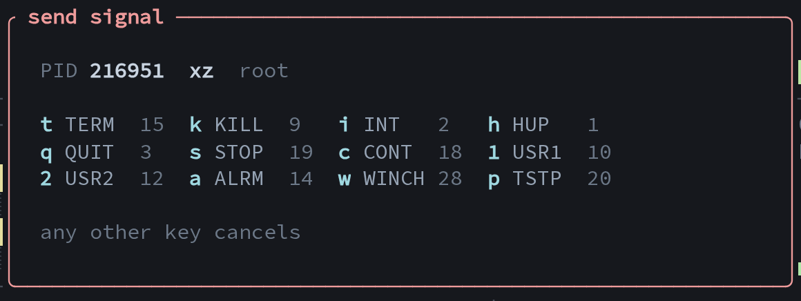

| Key | Signal | | Key | Signal |
|---|---|---|---|---|
| `t` | TERM (15) — ask to exit | | `q` | QUIT (3) |
| `k` | KILL (9) — force exit | | `s` | STOP (19) — freeze |
| `i` | INT (2) — as `Ctrl+C` | | `c` | CONT (18) — unfreeze |
| `h` | HUP (1) — often "reload" | | `1`, `2` | USR1 (10), USR2 (12) |
| `a` | ALRM (14) | | `w` | WINCH (28) |
| `p` | TSTP (20) | | | |

**Renice menu.** `↑` or `+` raises the nice value (lower priority), `↓` or `-` lowers it (higher
priority), from −20 (highest) to 19 (lowest); `Enter` applies it and any other key cancels.

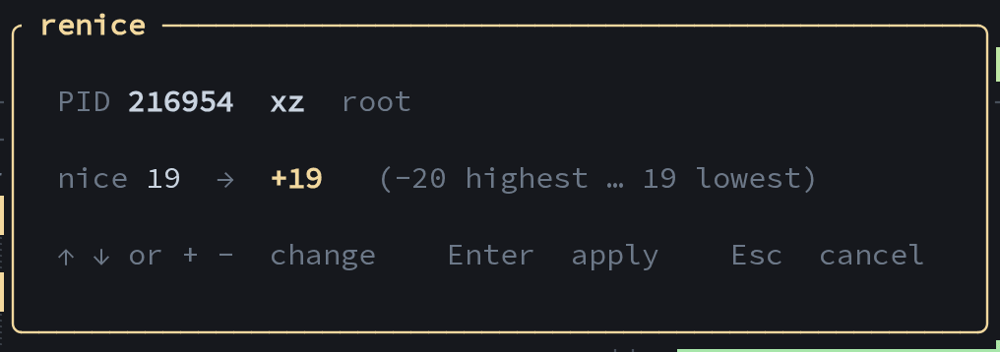

### Network

| Key | Action | Explanation |
|---|---|---|
| `n`, `b` | Next or previous interface | Steps through every interface, including bridges and virtual ones. |
| `a` | Automatic | Returns to following the busiest physical port. |
| `m` | Graph scale | Steps through: link speed (default) → auto → each fixed scale below the link speed (100M, 1G, 10G, 25G, 40G, 100G) → link speed. The header confirms the choice. |


*After `m` on a 10 Gbit/s port: the scale steps from the link speed to `auto`.*

<a id="disks-menu"></a>
### Disks menu

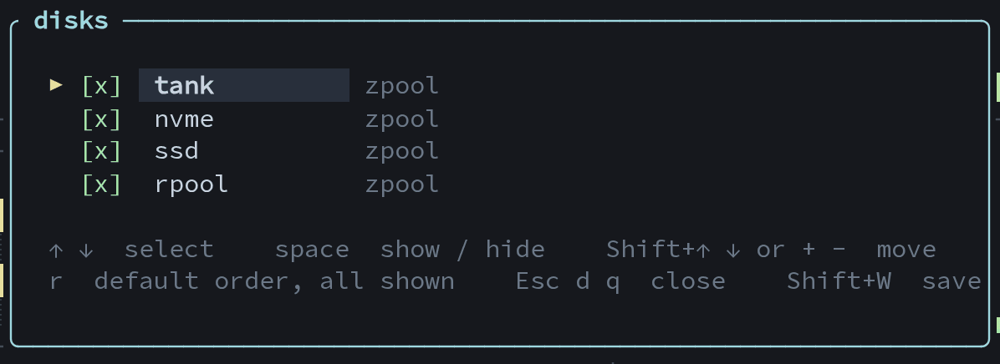

| Key | Action |
|---|---|
| `↑` `↓`, `Home` `End` | Select a row. |
| `Space`, `Enter` | Show or hide the selected disk or pool. |
| `Shift+↑` `Shift+↓`, `+` `-` | Move the selected row up or down. |
| `r` | Default order, everything shown. |
| `W` (`Shift`+`W`) | Save the choice to the configuration file. |
| `Esc`, `d`, `q` | Close the menu. |

### Mouse

With `mouse = true` (the default): a click selects a process, a second click on the selected row
opens its detail box, and the wheel scrolls three rows at a time.

### Vim keys

With `vim_keys = true` in the configuration: `j` `k` move down and up, `h` `l` change the sort
column, `g` `G` jump to the first and last process, and the signal menu moves to `K`.

---

## 8. Understanding the Interface


| No. | Area | What it shows |
|---|---|---|
| 1 | **Header** | Host name, clock, uptime, sampling interval; battery and istop's own container when they apply; messages after a key press. |
| 2 | **CPU summary line** | Load averages, running and blocked tasks, processes, threads, context switches, interrupts, clock (and power as root). |
| 3 | **CPU breakdown** | How the processor time was spent; temperature, power and clock bars where available. |
| 4 | **Per-thread bars** | One bar per hardware thread. |
| 5 | **CPU history** | Ten minutes of total CPU busy. |
| 6 | **Memory** | Used, cache, ZFS ARC and swap. |
| 7 | **Disks** | Local filesystems and ZFS pools: busy history, rates, space. |
| 8 | **Network** | Receive and send graphs for one interface. |
| 9 | **Processes** | The process list or tree. |

### Colours

Bars are coloured cell by cell along a ramp from green through amber to red, so a bar's colour at
its tip says how full it is before you read the number. The dotted part of each row is the empty
track. Figures follow the same colours.

### Header (1)

`istop`, the host name, the clock (local time, read from `/etc/localtime`), `up` and the time since
boot, then the sampling interval. On a laptop, the battery's charge (and draw, where reported)
appears; if istop itself runs inside a container, its type (`docker`, `podman`, `lxc` and so on)
is shown. Messages such as `sent TERM to 1234` or `network graph scale: 100Mbit/s` appear here
briefly.

### CPU (2–5)

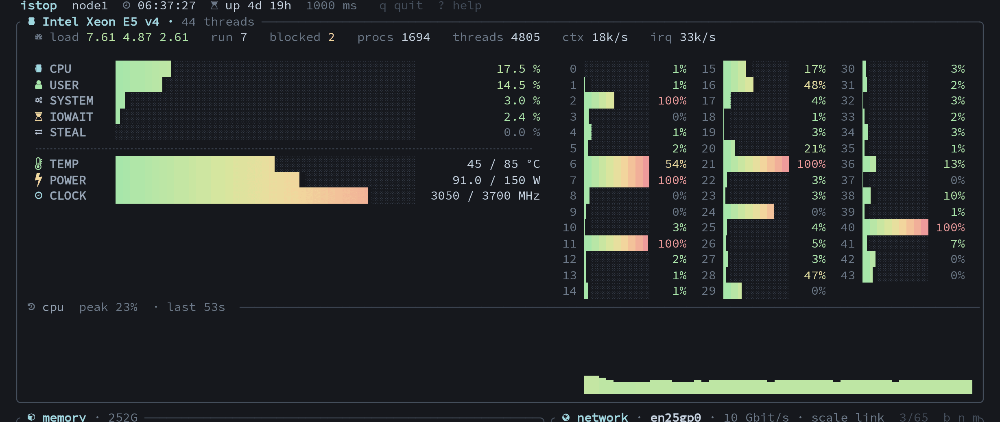

The box title names the CPU model and the number of hardware threads.

| Item | Meaning |
|---|---|
| `load` | The 1-, 5- and 15-minute load averages: roughly, how many tasks were running or waiting to run. Compare with the thread count. |
| `run`, `blocked` | Tasks running now, and tasks blocked waiting for I/O. |
| `procs`, `threads` | Processes and threads in existence. |
| `ctx`, `irq` | Context switches and interrupts per second. |
| `clock` | The mean current clock of the CPU threads, from cpufreq (`scaling_cur_freq`); without cpufreq, as in most VMs, from `/proc/cpuinfo`. |
| `power` | CPU package power, as root only. |
| **CPU** | Busy: all time except idle and iowait. |
| **USER**, **SYSTEM** | Time running programs, and time in the kernel on their behalf. |
| **IOWAIT** | Idle time during which I/O was outstanding — a sign that disks are the bottleneck. |
| **STEAL** | Time the hypervisor gave to another guest; only ever non-zero inside a VM. |
| **TEMP** | CPU package temperature against its critical limit (shown where a sensor exists). |
| **POWER** | CPU package draw against the long-term power limit (PL1), as root. |
| **CLOCK** | Current clock against the maximum. |
| Per-thread bars | Busy share of each hardware thread, numbered from 0. |
| History | Total CPU busy, one column per sample, newest at the right; the title shows the peak and the span shown. |

### Memory (6)

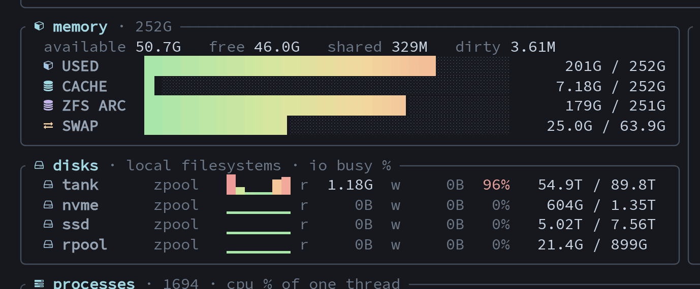

| Item | Meaning |
|---|---|
| Title figure | Total memory. |
| `available` | Memory that could be given to a new program without swapping — the kernel's own estimate (`MemAvailable`). |
| `free` | Memory not used for anything. Low `free` is normal; Linux uses spare memory as cache. |
| `shared`, `dirty` | Shared memory (`tmpfs` and similar), and data waiting to be written to disk. |
| **USED** | Total minus available. |
| **CACHE** | File cache and reclaimable kernel memory. |
| **ZFS ARC** | On ZFS hosts: the ARC's size against its maximum. The kernel counts the ARC in USED although most of it can be reclaimed, so this bar shows how much of USED is ARC. |
| **SWAP** | Swap in use against swap total. |

### Disks (7)

| Column | Meaning |
|---|---|
| Name | Mount point, or ZFS pool name. |
| Type | Filesystem type, or `zpool`. |
| Busy history | A small graph of how busy the device has been: the share of time it had I/O in flight. |
| `r`, `w` | Read and write rates in bytes per second. |
| `%` | Busy now. |
| Space | Used and total. For a pool, as `zfs list` counts it (parity excluded). |

Only local filesystems are shown, one row per device, and at most six rows; the disks menu (`d`)
chooses which. ZFS datasets are not listed individually: each pool appears once, with I/O added up
over its member disks.

### Network (8)

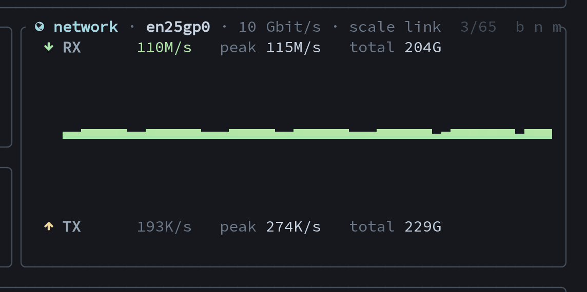

| Item | Meaning |
|---|---|
| Title | Interface name, graph scale, its position among the interfaces (`1/1`) and the keys `b` `n` `m`. |
| **RX**, **TX** | Receive and send rates now, the peak in view, and the total since boot. |
| Graphs | Receive above, send below, newest at the right. |

The **scale** decides what full height means. `link` (default) uses the port's negotiated link
speed, so the graph's height shows how much of the port is in use; `auto` fits the traffic in view;
fixed scales use a set rate and are never larger than the link speed. Interfaces that report no
speed (bridges, most virtual NICs) are drawn automatically under `link`.

### Processes (9)

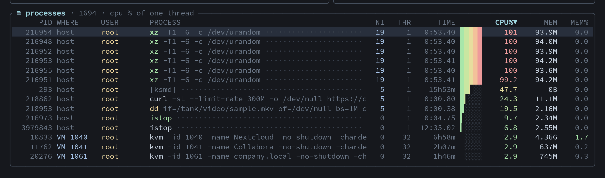

| Column | Meaning |
|---|---|
| **PID** | Process ID. |
| **WHERE** | `CT n` or `VM n` on Proxmox VE, `docker`, `podman`, or `host`. |
| **USER** | The owner; inside an unprivileged container, the name from that container's own user list. |
| **PROCESS** | The program name, followed by its arguments in a dimmer colour. In tree view, branches are drawn with `├─` and `└─`; an unfolded parent is marked `-`, and a folded one `+N` (in amber, with N its number of children) — its row then shows the totals of the whole branch. With guests first (`v`), a guest row shows the guest's name in blue, marked `+N` with N its number of processes, then what its configuration allows, dimmed: `22 cores · 16.0G` (a VM's vCPUs and memory; a container's core and memory limits, where set). PID, USER and NI are blank, and the figures are the sums of all its processes, whatever the filter. A faint dotted line fills the rest of the column on every row, to lead the eye to the figures. |
| **NI** | Nice value: −20 (highest priority) to 19 (lowest). |
| **THR** | Number of threads. |
| **TIME** | CPU time used since the process started (minutes:seconds.hundredths). |
| Bar, **CPU%** | CPU use over the last sample, of one thread by default (`c` changes the basis). |
| **MEM**, **MEM%** | Resident memory, and its share of total memory. |

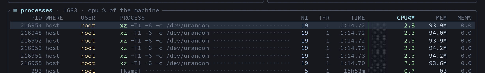

*After `c`: the title reads `cpu % of the machine`, and each single-threaded `xz` process reads
about 2.3 % of this 44-thread machine instead of 100 %.*

### The detail box


| Field | Meaning |
|---|---|
| History graph (left) | The process's CPU use since the box opened, with its peak and scale. |
| Title line | PID, name and state (`running`, `sleeping`, `disk sleep`, `stopped`, `zombie`…). |
| `parent` | Parent PID and name. |
| `user`, `where` | Owner and container. |
| `running` | Time since the process started. |
| `cpu time` | CPU time used. |
| `nice`, `threads` | Priority and thread count. |
| `memory`, `cpu` | Resident memory (and share), and current CPU use. |
| `disk io` | Bytes read and written since start, and the current rates. Other users' processes need root. |
| `cgroup` | The process's control group path. |
| `command` | The full command line. |

### Units

| Unit | Meaning |
|---|---|
| `B`, `K`, `M`, `G`, `T` | Bytes, kibibytes, mebibytes, gibibytes, tebibytes (binary: 1 K = 1024 bytes). |
| `/s` | Per second. |
| `bit/s` | Network scales are in bits per second (link speeds); rates beside the graphs are in bytes per second. |
| `%` | Share of time, or share of a total. |
| `°C`, `W`, `MHz` | Degrees Celsius, watts, megahertz. |

### Measured, calculated and estimated values

| Kind | Values |
|---|---|
| **Measured** (read directly) | Temperatures, clock, memory figures, load averages, link speed, space used, process memory and thread counts. |
| **Calculated** (from two readings and the time between them) | Every CPU percentage; context switches and interrupts per second; disk and network rates; disk busy; CPU power (energy ÷ time); process CPU %. |
| **Display only** | Damped bar lengths. |

---

## 9. Advanced Usage

### Command-line options

| Option | Meaning | Default |
|---|---|---|
| `-i`, `--interval <MS>` | Sampling interval in milliseconds, 100–10000. | 1000 |
| `-s`, `--sort <KEY>` | Process sort: `pid` `where` `user` `name` `nice` `threads` `time` `cpu` `mem`. | `cpu` |
| `-r`, `--reverse` | Reverse the sort. | |
| `-f`, `--filter <TEXT>` | Initial process filter. | |
| `--tree` | Start in tree view. | |
| `--guests` | Start with Proxmox VMs and containers first, one row each. | |
| `-c`, `--config <FILE>` | Configuration file. | `~/.config/istop/istop.conf` |
| `--default-config` | Print the default configuration, with descriptions, and exit. | |
| `--once` | Print one plain-text snapshot and exit. | |
| `--no-smooth` | Raw, undamped bars. | damped |
| `--damping <SEC>` | Seconds for a bar to fall by about 90 %, 0.2–30. | 4 |
| `--fps <N>` | Animation frame rate while bars move, 5–240. | 30 |
| `--no-icons` | ASCII markers instead of Nerd Font glyphs. | icons |
| `-V`, `--version` | Print the version and exit. | |
| `-h`, `--help` | Print the help text and exit. | |

Settings come from the configuration file first; command-line options override them.

### Configuration file

The file is `$XDG_CONFIG_HOME/istop/istop.conf`, normally `~/.config/istop/istop.conf`, or the file
given with `-c`. It is plain text: one `key = value` per line, `#` for comments. A good start is
the default file with every option described:

```sh
mkdir -p ~/.config/istop && istop --default-config > ~/.config/istop/istop.conf
```

| Key | Values | Default | Meaning |
|---|---|---|---|
| `update_ms` | 100–10000 | `1000` | Sampling interval in milliseconds. |
| `sort` | `pid` `where` `user` `name` `nice` `threads` `time` `cpu` `mem` | `cpu` | Process sort column. |
| `reverse` | `true`, `false` | `false` | Sort the opposite way. |
| `tree` | `true`, `false` | `false` | Start in tree view. |
| `guests` | `true`, `false` | `false` | Proxmox VMs and containers first, one row each. |
| `guest_order` | `vmid`, `vm-first`, `ct-first` | `vmid` | Order of the guest rows: by VMID, or each type by VMID. |
| `per_core` | `true`, `false` | `true` | CPU % of one thread (`true`) or of the machine. |
| `kernel_threads` | `true`, `false` | `true` | List kernel threads. |
| `smooth` | `true`, `false` | `true` | Damped bars. |
| `damping` | 0.2–30 | `4` | Seconds for a bar to fall by about 90 %. |
| `fps` | 5–240 | `30` | Animation frame rate while bars move. |
| `icons` | `true`, `false` | `true` | Nerd Font glyphs. |
| `vim_keys` | `true`, `false` | `false` | `h` `j` `k` `l` `g` `G` in the process list; signals on `K`. |
| `mouse` | `true`, `false` | `true` | Mouse support. |
| `clock` | `true`, `false` | `true` | Clock in the header. |
| `shown_boxes` | any of `cpu mem net proc` | all four | Boxes shown at start. |
| `net_iface` | interface name, or empty | empty | Interface shown at start; empty follows the busiest physical port. |
| `net_scale` | `link`, `auto`, `100M`, `1G`, `10G`, `25G`, `40G`, `100G` | `link` | Network graph full height. |
| `disk_order` | mount points or pool names, comma-separated | empty | These first, in this order; any other follows. |
| `disk_hidden` | mount points or pool names, comma-separated | empty | Never shown. |

The file is written **only when you press `W` (`Shift`+`W`)**, so experimenting never changes it. A disk listed in
neither `disk_order` nor `disk_hidden` appears after the ordered ones, so a new mount is never lost
silently. If a line is invalid, istop reports it with its line number and applies the rest.

Example:

```ini
# ~/.config/istop/istop.conf
sort = mem
tree = true
vim_keys = true
net_iface = eno1
net_scale = 10G
disk_order = /, tank
disk_hidden = /boot/efi
```

### Network scale in detail

On a 10 Gbit/s port, `m` steps link (10G) → auto → 100M → 1G → link. A fixed setting above a port's
speed (40G saved, then shown on a 10G port) is drawn at the link speed. Interfaces that report no
speed are drawn automatically under `link` and offer every fixed step.

### Scripting with `--once`

`--once` samples for one interval, prints a snapshot and exits. Machine-wide figures are
`key value` lines; disks, interfaces and processes are one line each of `key=value` pairs. Sizes
are in bytes (`_b`), rates in bytes per second (`_bps`), and a figure the machine does not report is
`n/a`. A real sample, abridged, from the demonstration machine:

```text
host              demo
cpu_model         QEMU Virtual version 2.5+
threads           22
cpu_busy_pct      11.8
cpu_user_pct      8.2
cpu_system_pct    3.6
cpu_iowait_pct    0.0
cpu_steal_pct     0.0
cpu_cores_pct     33 24 9 11 13 6 8 7 15 9 21 12 15 9 7 9 6 12 13 9 8 8
load              2.01 2.44 2.38
temp_c            n/a
cpu_watts         n/a
freq_mhz          2199
uptime_s          14288
mem_total_b       16698425344
mem_used_b        4531499008
mem_available_b   12166926336
zfs_arc_b         467973792
zfs_arc_max_b     15624683520
disk path=/ fs=btrfs used_b=44028092416 total_b=59591622656 read_bps=407800 write_bps=0 busy_pct=1
disk path=tank fs=zpool used_b=6289717720 total_b=7966982144 read_bps=0 write_bps=0 busy_pct=0
net iface=enp6s18 physical=true rx_bps=58510 tx_bps=1836288 rx_b=9364931574 tx_b=23734618097
proc pid=3 ppid=1 where=host user=root comm=istop nice=0 threads=1 time_s=0.00 cpu=0.0% rss_b=770048 mem=0.0%
```

- The process lines are the first 25 in the current sort, after any `-f` filter, so
  `istop --once -s mem` lists the 25 largest.
- With `--guests` (or `guests = true`), every Proxmox guest comes first as a `guest` line —
  `where`, `name`, `procs`, `threads`, `time_s`, `cpu`, `rss_b`, `mem`, its processes added
  together — and the `proc` lines are the host's own processes.
- `--once` reports every disk, including those hidden in the configuration.
- A value containing spaces, quotes or control characters is double-quoted with `\\`, `\"` and
  `\xNN` escapes, as in `where="CT 101"`. Process names are set by whatever runs in a container, so
  they are never printed raw.

Examples:

```sh
# The busy figure of every disk
istop --once | awk '$1=="disk" {print $2, $NF}'

# The five processes using the most memory
istop --once -s mem | grep '^proc' | head -5

# Warn when available memory falls below 1 GiB
istop --once | awk '$1=="mem_available_b" && $2 < 1073741824 {print "low memory:", $2}'
```

---

## 10. Technical Details

### Architecture

istop is a single Rust binary of about 5,600 lines in nine modules, with
`#![forbid(unsafe_code)]`: system calls go through [rustix](https://github.com/bytecodealliance/rustix),
which makes them directly rather than through the C library.

| Module | Responsibility |
|---|---|
| `main.rs` | Command-line parsing, `--once`, the event loop, keys and mouse. |
| `sys.rs` | Readers for `/proc` and `/sys`: CPU, memory, ARC, mounts, ZFS pools, disks, network, hostname. Each function is a plain read of current counters. |
| `procs.rs` | The process table, tree, container and user resolution, detail box, signals and renice. |
| `power.rs` | CPU package power from RAPL, and the battery. |
| `app.rs` | Joins the samplers, works out rates, keeps history and the damped values. |
| `config.rs` | The configuration file: parsing, defaults and saving. |
| `clock.rs` | Local time from `/etc/localtime` (TZif), without a date library. |
| `ui.rs` | Rendering with ratatui; bars and graphs are written cell by cell. |
| `theme.rs` | Colour ramp and glyphs, shared with igtop and iztop. |

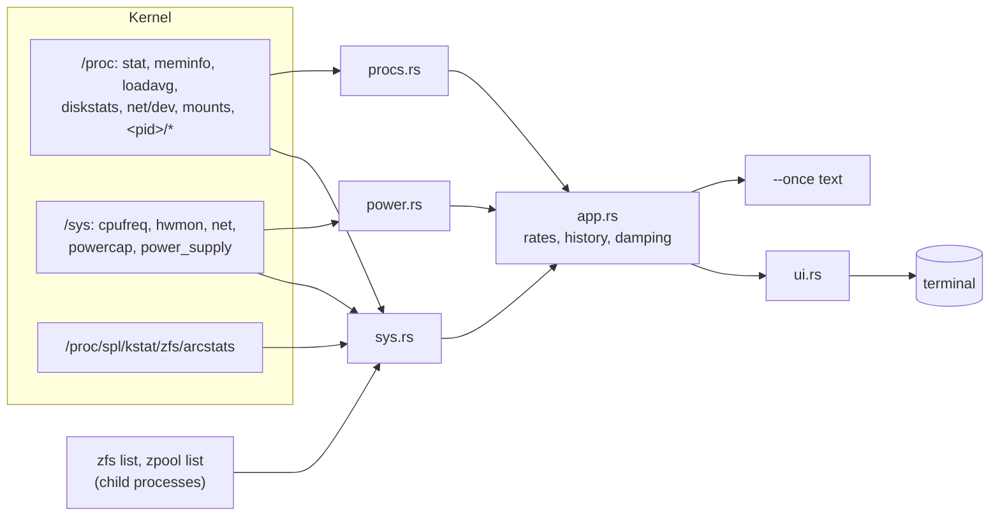

### Data sources

| Figure | Source |
|---|---|
| CPU busy, user, system, iowait, steal | `/proc/stat`, as differences between two readings. |
| Model, thread count | `/proc/cpuinfo`. |
| Clock | `/sys/devices/system/cpu/cpu*/cpufreq` (`scaling_cur_freq`, maximum from `cpuinfo_max_freq`), else `/proc/cpuinfo`. |
| Temperature | `/sys/class/hwmon`: Intel `coretemp` (`Package id N`), AMD `k10temp` (`Tctl`/`Tdie`) or `zenpower`, or the `cpu_thermal`/`soc_thermal` zone. The limit is the sensor's `crit` (or `max`) value, else 100 °C for coretemp and 95 °C otherwise. |
| Power and limit | RAPL package energy counters and `constraint_0_power_limit_uw` in `/sys/class/powercap`. Root only. |
| Load, uptime | `/proc/loadavg`, `/proc/uptime`. |
| Memory | `/proc/meminfo`; USED is `MemTotal − MemAvailable`. |
| ZFS ARC | `/proc/spl/kstat/zfs/arcstats` (`size`, `c_max`). |
| Filesystems | `/proc/mounts` filtered to local types (ext2/3/4, XFS, Btrfs, ZFS, VFAT, exFAT, F2FS, NTFS, bcachefs, JFS, ReiserFS, NILFS2), space from `statvfs`. |
| ZFS pools | `zfs list -Hp -d 0` every 10 s; members from `zpool list -vHP` every minute. |
| Disk rates and busy | `/proc/diskstats`: sectors read and written, and milliseconds with I/O in flight. |
| Network | `/proc/net/dev`; link speed from `/sys/class/net/<if>/speed`; an interface with a `device` link is a physical port. |
| Processes | `/proc/<pid>/stat`, `cmdline`, `cgroup`, `io`, `exe`, `uid_map`, and the container's own `/etc/passwd` through `/proc/<pid>/root`. |
| Battery | `/sys/class/power_supply`. |

### Process CPU and containers

CPU is the change in a process's `utime + stime` between two scans, against the wall time between
them, as a share of **one** CPU — the convention `top` and `ps` use. Processes are rescanned once a
second at most, whatever the sampling interval.

**WHERE** is read from each process's cgroup path: `/lxc/<id>` or `/lxc.payload.<id>` is a Proxmox
container, `qemu.slice/<id>.scope` a Proxmox VM's QEMU process, and `docker`/`libpod` paths Docker
and Podman. **USER** inside an unprivileged container is resolved by mapping the UID back through the
process's `uid_map` and looking it up in the container's own `/etc/passwd`.

With guests first, a guest's name, cores and memory come from its configuration in `/etc/pve`
(`name`, `vcpus` or `cores` × `sockets`, and `memory` for a VM; `hostname`, `cores` and `memory` for a
container; root only). Without it, a VM's name comes from QEMU's `-name` argument. Its memory is the sum of
its processes' resident memory, so pages shared between a container's processes count more than once;
it is not the guest's cgroup total, which also counts page cache.

### Damping

Bars rise quickly and fall slowly; the time constants are in seconds, so the feel does not depend on
the sampling or frame rate. Between samples istop redraws at up to `--fps` only while a bar is
moving, and sleeps once everything has settled. Damping affects only bar lengths: figures and
`--once` are raw.

### Safety

- Network filesystems are never queried: `statvfs` on an NFS or CIFS mount whose server is down
  blocks, which would freeze the display.
- The ZFS commands run in child processes with no input and their errors discarded.
- Signals and renice go only to the process selected, through an explicit menu.

### Dependencies

| Crate | Version | Purpose |
|---|---|---|
| [ratatui](https://ratatui.rs/) | 0.29.0 | Terminal user interface. |
| [crossterm](https://github.com/crossterm-rs/crossterm) | 0.28.1 | Terminal input and output, mouse. |
| [rustix](https://github.com/bytecodealliance/rustix) | 0.38 | System calls (`statvfs`, signals, priority, user IDs) without `unsafe` code in istop. |

### Limitations

- Linux on x86-64 only.
- Network filesystems (NFS, CIFS, SSHFS) are not shown, by design.
- At most six disk rows are shown; the disks menu chooses which.
- Container labels cover Proxmox, Docker and Podman; other runtimes show as `host`.
- One network interface is drawn at a time; `n` and `b` step through the rest.

How istop compares with btop, and why each btop feature was or was not adopted:
[docs/btop-analysis.md](docs/btop-analysis.md).

---

## 11. Development

### Building

| Task | Command |
|---|---|
| Debug build | `cargo build` |
| Optimised build for this machine | `cargo build --release` → `target/release/istop` |
| Static, portable binary | `./build.sh` → `target/x86_64-unknown-linux-musl/release/istop` |
| Tests | `cargo test` |
| Lints, as CI runs them | `cargo clippy --all-targets -- -D warnings` |

The minimum Rust version is **1.88**, set by the locked dependencies in `Cargo.lock`; the project
builds with 1.88.0 and with current stable.

<a id="static-builds"></a>
### Static builds

`build.sh` produces a musl-linked static binary for baseline x86-64, so it runs on any x86-64 Linux
and any x86-64 CPU. It needs the musl target, and `objdump` (from binutils) for its final check:

```sh
rustup target add x86_64-unknown-linux-musl
./build.sh
```

The script refuses the result if it contains AVX-512 instructions. Some distributions (CachyOS, for
one) ship a Rust standard library built for x86-64-v4, which puts AVX-512 instructions in every
binary regardless of `-C target-cpu`; such a binary dies with `Illegal instruction` on older CPUs.
If `build.sh` reports this, rebuild the standard library from source:

```sh
rustup component add rust-src
ISTOP_BUILD_STD=1 ./build.sh
```

### Packaging

| Path | Purpose |
|---|---|
| `Cargo.toml` → `[package.metadata.deb]` | Debian package, built with `cargo deb`. |
| `Cargo.toml` → `[package.metadata.generate-rpm]` | RPM package, built with `cargo generate-rpm`. |
| `packaging/aur/PKGBUILD`, `.SRCINFO` | Arch Linux package. |
| `.github/workflows/ci.yml` | On every push: clippy, tests and `build.sh`. |
| `.github/workflows/release.yml` | On a published release: builds the static binary, `.deb`, `.rpm` and `SHA256SUMS`, tests them in eight distribution containers, then uploads them. |
| `.github/workflows/aur.yml` | On a published release: updates and pushes the AUR package (awaiting an AUR account). |

### Contributing and reporting problems

Bug reports and pull requests are welcome through
[GitHub issues](https://github.com/GladTechInfo/istop/issues). Please include `istop --version`,
the distribution and kernel (`uname -r`), and, where a figure looks wrong, the output of
`istop --once`. Before sending a pull request, run `cargo clippy --all-targets -- -D warnings` and
`cargo test`.

---

## 12. Licence

istop is free software, licensed under the **GNU General Public License v3.0 or later**
(`GPL-3.0-or-later`). See [LICENSE](LICENSE) for the full text.

It is built with [ratatui](https://ratatui.rs/) and
[crossterm](https://github.com/crossterm-rs/crossterm) (both MIT-licensed) and
[rustix](https://github.com/bytecodealliance/rustix) (Apache-2.0 WITH LLVM-exception, Apache-2.0
or MIT). Its interface follows [igtop](https://github.com/GladTechInfo/igtop); the comparison with
[btop](https://github.com/aristocratos/btop) is in [docs/btop-analysis.md](docs/btop-analysis.md).
