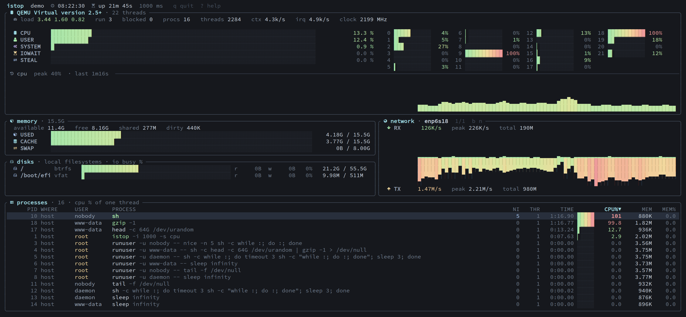

# istop

A terminal system monitor — CPU, memory, disks, network and processes — in the style of
[igtop](https://github.com/GladTechInfo/igtop): pastel gradient bars coloured cell by cell, rounded
boxes, damped motion. It knows about Proxmox, Docker and Podman, so every process is labelled with
the container or VM it runs in, and about ZFS, so pools and the ARC are shown as ZFS counts them.
Written entirely in Rust, with no `unsafe` code; one static binary with no dependencies.



**Contents:** [Quick start](#quick-start) · [What it shows](#what-it-shows) ·
[Requirements](#requirements) · [Installing](#installing) · [Building](#building) ·
[Usage](#usage) · [Keys](#keys) · [Configuration](#configuration) · [`--once` format](#--once-format) ·
[How the figures are measured](#how-the-figures-are-measured) · [Troubleshooting](#troubleshooting) ·
[Limitations](#limitations)

How it compares with btop, and why each btop feature was or was not taken up:
[docs/btop-analysis.md](docs/btop-analysis.md).

## Quick start

On Debian, Ubuntu or Proxmox:

```sh
ver=$(curl -s https://api.github.com/repos/GladTechInfo/istop/releases/latest | sed -n 's/.*"tag_name": "v\(.*\)".*/\1/p')
curl -LO "https://github.com/GladTechInfo/istop/releases/download/v$ver/istop_${ver}-1_amd64.deb"
sudo apt install "./istop_${ver}-1_amd64.deb"
istop            # q quits, ? lists every key
```

Other distributions: see [Installing](#installing).

## What it shows

* **CPU** — busy, user, system, iowait and steal; temperature, package power and clock where the
  hardware reports them; a bar per thread; ten minutes of history; load, context switches and
  interrupts.
* **Memory** — used, cache and swap, and on ZFS hosts the ARC against its ceiling.
* **Disks** — local filesystems: space, read and write rates, and a history of how busy each
  device is. ZFS is shown per pool (`fs=zpool` in `--once`): space as `zfs list` counts it, I/O from the pool's member
  disks. Press `d` to choose which disks are shown and in what order.
* **Network** — receive and send graphs for one interface, by default scaled to the port's link
  speed so the height shows how much of the link is in use; follows the busiest physical port
  unless you choose one.
* **Processes** — flat list or tree; sortable by PID, container, user, name, nice, threads, CPU
  time, CPU or memory; filter; a detail box with CPU history, disk I/O, cgroup and command line;
  signals and renice. The **WHERE** column names the Proxmox CT or VM, Docker or Podman container
  each process runs in; users inside unprivileged containers are shown by their own names.
* **Header** — host name, clock, uptime, battery, and the container istop itself runs in.

`istop --once` prints the same figures as plain text for scripts.

## Requirements

- Linux on x86-64. Everything is read from `/proc` and `/sys`; there is no daemon and nothing to
  configure first.
- **Runs as any user.** Root adds three things: CPU package power (the RAPL counters are
  root-only), the disk I/O of other users' processes, and signals or renice for processes you do
  not own.
- On ZFS hosts, the `zfs` and `zpool` commands (from `zfsutils-linux` or your distribution's
  equivalent) for pool space and members; the ARC needs only the kernel module.
- A [Nerd Font](https://www.nerdfonts.com/) for the icons, or `--no-icons`.

## Installing

Each [release](https://github.com/GladTechInfo/istop/releases/latest) carries ready-made builds:

| File | For | Installs to |
|---|---|---|
| `istop_<version>-1_amd64.deb` | Debian, Ubuntu, Proxmox VE | `/usr/bin/istop` |
| `istop-<version>-1.x86_64.rpm` | Fedora, RHEL, Rocky, Alma, openSUSE | `/usr/bin/istop` |
| `istop-<version>-x86_64-linux` | Any x86-64 Linux, including Alpine | wherever you put it |
| `SHA256SUMS` | Checksums of the three above | |

All three contain the same static binary, so they behave identically on any distribution and need
no libraries. Before a release's files are uploaded, each package is installed, run and removed in
containers of Debian 12 and 13, Ubuntu 22.04 and 24.04, Fedora, Rocky Linux 9, openSUSE Tumbleweed
and Alpine.

### Download and check

```sh
# the latest release; or set ver=X.Y.Z for a particular one
ver=$(curl -s https://api.github.com/repos/GladTechInfo/istop/releases/latest | sed -n 's/.*"tag_name": "v\(.*\)".*/\1/p')
base=https://github.com/GladTechInfo/istop/releases/download/v$ver
curl -LO "$base/SHA256SUMS"
curl -LO "$base/istop_${ver}-1_amd64.deb"      # or the .rpm, or the binary
sha256sum --check --ignore-missing SHA256SUMS  # must print "OK"
```

### Install

```sh
sudo apt install ./istop_*_amd64.deb                            # Debian, Ubuntu, Proxmox
sudo dnf install ./istop-*.x86_64.rpm                           # Fedora, RHEL and rebuilds
sudo zypper install --allow-unsigned-rpm ./istop-*.x86_64.rpm   # openSUSE
sudo install -m 0755 istop-*-x86_64-linux /usr/local/bin/istop  # anything else
```

`istop --version` confirms what is installed. The packages are not signed; `SHA256SUMS` is the
check that a download is the one published here.

### Updating and removing

To update, install the newer package the same way; `apt` and `dnf` replace the old version. To
remove: `sudo apt remove istop`, `sudo dnf remove istop`, `sudo zypper remove istop`, or delete the
binary you copied. The only file istop writes is `~/.config/istop/istop.conf`, and only when you
press `W`; delete it to return to the defaults.

### Arch Linux and derivatives

An AUR package is on its way (AUR account registration is paused at the time of writing). Until
then, build the same package from this repository; it compiles istop from the release's source:

```sh
git clone https://github.com/GladTechInfo/istop
cd istop/packaging/aur && makepkg -si
```

## Building

With a Rust toolchain ([rustup](https://rustup.rs/)):

```sh
cargo build --release
./target/release/istop
```

For a **static binary** to copy to other machines — a hypervisor, say, where you would rather not
install a compiler:

```sh
rustup target add x86_64-unknown-linux-musl
./build.sh
# → target/x86_64-unknown-linux-musl/release/istop
```

`build.sh` targets baseline x86-64, so the binary runs on any x86-64 CPU, and refuses the result
if it contains AVX-512 instructions. Some distributions (CachyOS, for one) ship a Rust standard
library built for x86-64-v4, which puts AVX-512 in every binary regardless of `-C target-cpu`; such
a binary dies with `Illegal instruction` on older CPUs. If `build.sh` reports this, rebuild the
standard library from source:

```sh
rustup component add rust-src
ISTOP_BUILD_STD=1 ./build.sh
```

Tests: `cargo test`.

## Usage

```sh
istop                      # the monitor
sudo istop                 # adds CPU power and every process's disk I/O
istop -s mem               # sort processes by memory
istop -f nginx --tree      # start filtered, in tree view
istop -i 500               # sample twice a second
istop --once               # one plain-text snapshot, for scripts
istop --default-config     # print every setting with its description
```

| Option | Meaning | Default |
|---|---|---|
| `-i`, `--interval <MS>` | sampling interval, 100–10000 ms | 1000 |
| `-s`, `--sort <KEY>` | process sort: `pid` `where` `user` `name` `nice` `threads` `time` `cpu` `mem` | `cpu` |
| `-r`, `--reverse` | reverse the sort | |
| `-f`, `--filter <TEXT>` | initial process filter | |
| `--tree` | start in tree view | |
| `-c`, `--config <FILE>` | config file | `~/.config/istop/istop.conf` |
| `--default-config` | print the default config and exit | |
| `--once` | print one plain-text snapshot and exit | |
| `--no-smooth` | raw, undamped bars | damped |
| `--damping <SEC>` | seconds for a bar to fall ~90 %, 0.2–30 | 4 |
| `--fps <N>` | animation frame rate while bars move, 5–240 | 30 |
| `--no-icons` | ASCII markers instead of Nerd Font glyphs | icons |
| `-V`, `--version` | print the version and exit | |
| `-h`, `--help` | the full help text, with notes on each figure | |

Settings come from the config file, then from these options.

## Keys

Press `?` in istop for the full list.

| Key | Action |
|---|---|
| `q` `Esc` | quit (Esc first clears a filter or closes the detail box) |
| `↑ ↓ PgUp PgDn Home End` | select a process |
| `← →`, `r` | sort column, reverse |
| `/` `f` | filter |
| `Enter` | detail box |
| `e`, `E` | tree view; fold or unfold every branch |
| `Space` `+` `-` | pause, refresh rate — in tree view: fold and unfold |
| `k`, `N` | signal menu, renice |
| `u`, `c`, `t` | pause the list; CPU % of a thread or the machine; kernel threads |
| `1`–`4` | show or hide the CPU, memory, network and process boxes |
| `d` | disks menu: choose which disks and pools are shown, and in what order |
| `n` `b`, `a` | next or previous interface; back to automatic |
| `m` | network graph scale: link speed (default), auto, then 100M, 1G, 10G, 25G, 40G, 100G below it |
| `s`, `i` | damped or raw bars; icons or ASCII |
| `W` | save the current settings |
| `Ctrl+Z` | suspend |

Mouse: click selects a process, a second click opens its detail box, the wheel scrolls. With
`vim_keys = true` in the config, `j` `k` move in the process list, `h` `l` change the sort column,
`g` `G` jump to the top and bottom, and the signal menu moves to `K`. Help is also on `F1`.

## Configuration

`~/.config/istop/istop.conf` (or `-c FILE`), one `key = value` per line, `#` for comments.
`istop --default-config` prints every option with its description; a good start is

```sh
mkdir -p ~/.config/istop && istop --default-config > ~/.config/istop/istop.conf
```

Command-line options override the file. Settings are written back only when you press `W`, so
trying something in istop never changes the file by itself.

**Disks.** The disks menu (`d`): `↑ ↓` select, `Space` shows or hides, `Shift+↑ ↓` (or `+ -`) moves
the selected row, `r` returns to the default order with everything shown. The choice is kept as
`disk_order` and `disk_hidden` (mount points or ZFS pool names, comma-separated); a disk listed in
neither appears after the ordered ones, so a new mount is never silently lost. `--once` still
reports every disk.

**Network scale.** The network graph scale (`m`, kept as `net_scale`) is by default `link`: full
height is the interface's negotiated link speed, so a graph shows how much of the port is in use.
`auto` fits the graph to the traffic in view; the fixed scales are full heights in bit/s, and stop
below the link speed: on a 10 Gbit/s port `m` steps link (10G) → auto → 100M → 1G → link. A fixed
setting above a port's speed (40G saved on a faster port) draws it at its link speed. Interfaces
that report no speed (bridges, most virtual ones) are drawn automatic under `link` and offer every
fixed step. `net_iface` pins the interface shown at start; empty follows the busiest physical port.

## `--once` format

`--once` samples for one interval, prints a snapshot and exits. Machine-wide figures are
`key value` lines; disks, interfaces and processes are one line each of `key=value` pairs. Sizes
are in bytes (`_b`), rates in bytes per second (`_bps`); a figure the machine does not report is
`n/a`. For example (abridged):

```
host              demo
cpu_model         AMD Ryzen 7 5700G with Radeon Graphics
threads           16
cpu_busy_pct      5.8
cpu_iowait_pct    0.0
cpu_cores_pct     11 7 10 7 14 4 2 1 3 2 2 8 3 4 1 13
load              1.25 1.32 1.33
temp_c            48.5
cpu_watts         n/a
freq_mhz          3400
mem_total_b       16691732480
mem_used_b        5379928064
zfs_arc_b         2147483648
zfs_arc_max_b     8345866240
disk path=/ fs=ext4 used_b=23356985344 total_b=59591622656 read_bps=0 write_bps=40960 busy_pct=1
disk path=tank fs=zpool used_b=812345671680 total_b=3840000000000 read_bps=1048576 write_bps=0 busy_pct=4
net iface=eth0 physical=true rx_bps=103852 tx_bps=2404325 rx_b=584887480 tx_b=6790357753
proc pid=1031 ppid=1 where="CT 101" user=www-data comm=nginx nice=0 threads=4 time_s=12.79 cpu=4.1% rss_b=41290137 mem=0.2%
```

The process lines are the first 25 in the current sort, after any `-f` filter, so
`istop --once -s mem` lists the 25 largest. A value containing spaces, quotes or control
characters is double-quoted with `\\`, `\"` and `\xNN` escapes, as in `where="CT 101"`; process
names are set by whatever runs in a container, so they are never printed raw.

Example: the busy figure of every disk, from a script or cron job:

```sh
istop --once | awk '$1=="disk" {print $2, $NF}'
```

## How the figures are measured

**CPU.** From `/proc/stat`. Busy is everything but idle and iowait. iowait is idle time with I/O
outstanding, shown on its own bar. Steal is time the hypervisor gave to someone else, and is only
ever non-zero inside a VM. Temperature comes from the CPU's hwmon sensor, power from the
packages' RAPL counters in `/sys/class/powercap` (root only), clock from cpufreq.

**Memory.** USED is total minus `MemAvailable`, the kernel's own estimate of what could be given to
a new program. On a ZFS host the kernel counts the ARC in USED, although most of it can be
reclaimed; its own bar, from `/proc/spl/kstat/zfs/arcstats`, shows how much.

**Disks.** Local filesystems only, one row per device; network filesystems are left out
deliberately, because asking an unreachable server for its free space blocks. On ZFS only pool
roots are shown, with space from `zfs list` and I/O added up over the pool's member disks from
`zpool list`. Rates and the busy figure come from `/proc/diskstats`; busy is the share of time the
device had I/O in flight.

**Network.** Byte counters from `/sys/class/net`; the link speed from the interface's own `speed`.
An interface with a device behind it is a physical port; bridges, taps, veths, bonds and tunnels
have none, so they are never chosen automatically, though `n` and `b` reach them.

**Processes.** From `/proc/<pid>`. CPU % is of one thread by default, as top shows it: a process
using four threads flat out reads 400; `c` switches to a share of the whole machine. Processes are
rescanned once a second at most. TIME is CPU time used since the process started. WHERE is read
from each process's cgroup: `CT n` and `VM n` on Proxmox, Docker, Podman, or `host`. A user inside
an unprivileged container is looked up in that container's own user list, so it shows by its name
rather than as a shifted UID.

## Troubleshooting

**CPU power shows `n/a`.** RAPL counters are readable by root only; run istop with `sudo`. Inside
a VM or container they are usually not there at all.

**No temperature.** The CPU's sensor driver is not loaded (`k10temp` on AMD, `coretemp` on Intel),
or istop is in a VM. `ls /sys/class/hwmon/*/name` lists the sensors the kernel offers.

**A ZFS pool is missing from the disks box.** istop needs the `zfs` and `zpool` commands; check
that `zfs list` works. Also check `disk_hidden` in the config, or press `d`.

**A disk you hid is gone for good.** Press `d`, then `r`, to show every disk again in the default
order.

**Squares or question marks instead of icons.** The terminal font has no Nerd Font glyphs.
Install a [Nerd Font](https://www.nerdfonts.com/), or use `--no-icons` (`icons = false` to keep it).

**`Illegal instruction` from a binary you built yourself.** See [Building](#building): your Rust
standard library contains AVX-512.

## Limitations

- Linux on x86-64 only.
- Network filesystems (NFS, CIFS, SSHFS) are not shown; see [Disks](#how-the-figures-are-measured).
- Container labels cover Proxmox, Docker and Podman. Other runtimes show as `host`.
- One network interface is drawn at a time; `n` and `b` step through the rest.

## Reporting problems

Bug reports are welcome as [issues](https://github.com/GladTechInfo/istop/issues). Please include
`istop --version`, the distribution and kernel (`uname -r`), and, where a figure looks wrong, the
output of `istop --once`.

## Licence

GNU General Public License v3.0 or later. See [LICENSE](LICENSE).
